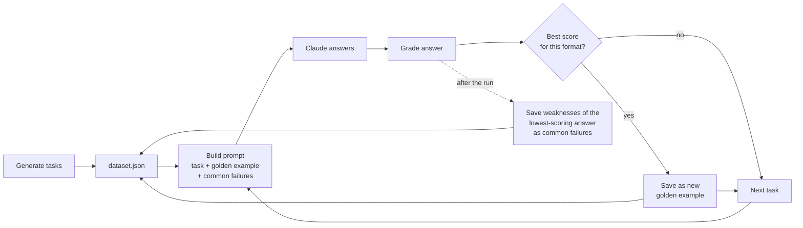

# Coding Problem Solving: Prompt Eval

A small evaluation pipeline that measures how well a prompt gets Claude to solve short AWS coding tasks, and uses each run's results to improve the prompt for the next run.

Everything lives in one notebook, [`Claude.ipynb`](Claude.ipynb). The test tasks and everything learned from earlier runs are stored in [`dataset.json`](dataset.json).

## What it does

1. **Generates a test dataset.** Claude writes 9 small AWS tasks: 3 that need a Python function, 3 that need a JSON document (such as an IAM policy) and 3 that need a regex.
2. **Runs each task through Claude.** Claude is asked to reply with only the code, in the required format.
3. **Grades every answer** in up to three ways (see [Scoring](#scoring)).
4. **Keeps the best answer for each format** as a "golden example", and records the mistakes that cost the most points.
5. **Uses both in the next run.** Each task's prompt shows Claude the golden example for its format and the mistakes to avoid, so the prompt improves over time.



## Scoring

Each answer gets up to three scores out of 10. Its final score is their average.

| Score | Type | How it works |
|---|---|---|
| **Model score** | Model-graded | Claude, acting as a code reviewer, rates the answer 1–10 and lists its strengths and weaknesses. |
| **Syntax score** | Code-graded | The answer is parsed with Python's own tools: `ast.parse` for Python, `json.loads` for JSON, `re.compile` for regex. It gets 10 if it parses and 0 if not. |
| **Resemblance score** | Model-graded | Claude rates 1–10 how closely the answer follows the style of the golden example for its format. This score is only given when a golden example exists. |

At the end of a run the notebook prints each task's scores and the overall average:

```
[regex] Write a regex that matches an AWS EC2 instance ID ...
  Model score: 9  |  Syntax score: 10  |  Resemblance score: 9  |  Average: 9.33
```

## How the prompt is built

Each task prompt follows these prompt-engineering practices:

- **XML tags** separate each part: `<task>`, `<instructions>`, `<example>`, `<common_failures>`.
- **A clearly labelled example:** "Here is an example input with an ideal response for a similar python task".
- **An explanation of why the example is ideal** (`<why_ideal>`), taken from the grader's strengths for that answer.
- **The most common failures to avoid** (`<common_failures>`), taken from the grader's weaknesses for the lowest-scoring answer in the previous run.
- **A relevant example:** each task only sees the example for its own format, and never its own earlier answer.

## The data file

`dataset.json` holds the tasks and everything carried over between runs:

```json
{
  "tasks": [
    { "task": "Write a regex that matches ...", "format": "regex" }
  ],
  "golden_examples": {
    "regex": {
      "task": "...",
      "output": "^i-(?:[0-9a-f]{8}|[0-9a-f]{17})$",
      "score": 9.5,
      "why_ideal": ["...", "..."]
    }
  },
  "common_failures": {
    "regex": ["...", "..."]
  }
}
```

A golden example is replaced whenever a later answer in the same format gets a higher final score. Each run uses the golden examples it started with, and any new ones are used from the next run onwards.

## Notebook overview

| Function | What it does |
|---|---|
| `chat` | Sends messages to Claude and returns only the text of the reply, skipping any "thinking" content. It can request a fixed JSON shape. |
| `generate_dataset` | Asks Claude for the 9 tasks, as JSON in a fixed shape. |
| `run_prompt` | Builds a task's prompt, with its example and common failures, and returns Claude's answer without code fences. |
| `grade_by_model` | Code-review grade: score, strengths, weaknesses and reasoning. |
| `grade_syntax` | Picks the right syntax checker for the task's format. |
| `grade_by_resemblance` | Style-similarity grade against the golden example. |
| `run_test_case` | Runs one task, applies all graders and averages the scores. |
| `run_eval` | Runs every task, prints the scores, and updates the golden examples and common failures in `dataset.json`. |

## Running it

**Requirements:** Python 3.10+ and an [Anthropic API key](https://console.anthropic.com/).

1. Install the packages:
   ```
   pip install anthropic python-dotenv ipykernel
   ```
2. Create a file named `.env` next to the notebook:
   ```
   ANTHROPIC_API_KEY=sk-ant-...
   ```
   `.env` is listed in `.gitignore`, so your key is never committed.
3. Open `Claude.ipynb` and run the cells from top to bottom.

**To keep the same tasks and keep improving the golden examples,** skip the two cells that generate and save the dataset, and just re-run the evaluation cells. Re-running the generate cell creates new tasks but keeps the existing golden examples.

A full run makes about 25–30 API calls with `claude-sonnet-5-5` and takes 3–4 minutes.

## Known limitations

- **Uneven averages.** Tasks with no example (including the task that owns the current golden example) are averaged over 2 scores instead of 3, which can make them easier to score highly on.
- **The grader doesn't know the "no commentary" rule.** The model grader sometimes marks answers down for missing explanations or docstrings, which the prompt tells Claude to leave out. Those points can then appear in `common_failures` and contradict the instructions.
- **Model graders vary.** Running the same answer twice can give slightly different scores, so judge prompt changes by trends across runs rather than single numbers.

## Background

This project started from an Anthropic course on prompt evaluation. It was updated for `claude-sonnet-5-5` and version 1.x of the `anthropic` Python library:

- **No `temperature`:** the library no longer accepts it.
- **No prefilled answers:** the model rejects them, so the notebook requests a fixed JSON shape for structured output, and strips code fences from answers instead.
- **Text blocks only:** replies are read from their text blocks, because the model's thinking can come before the answer.
